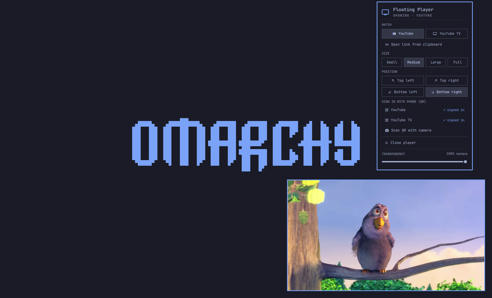
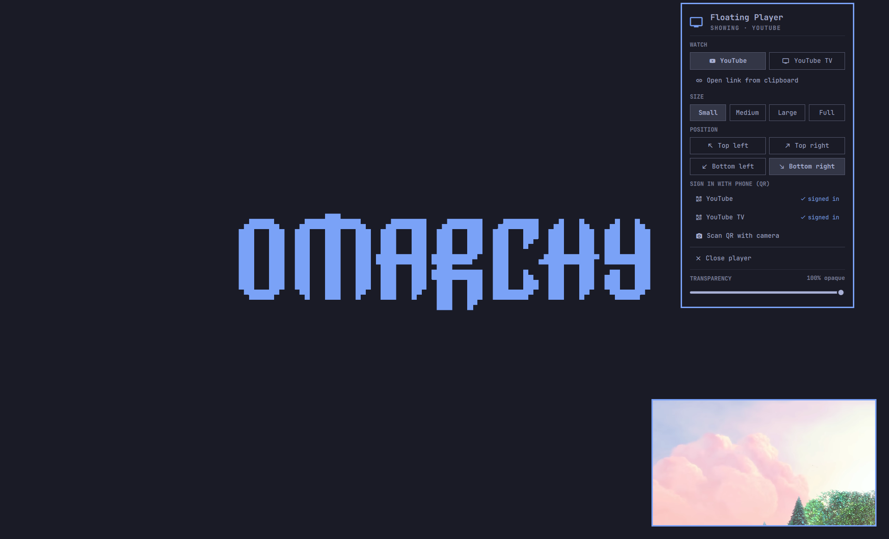
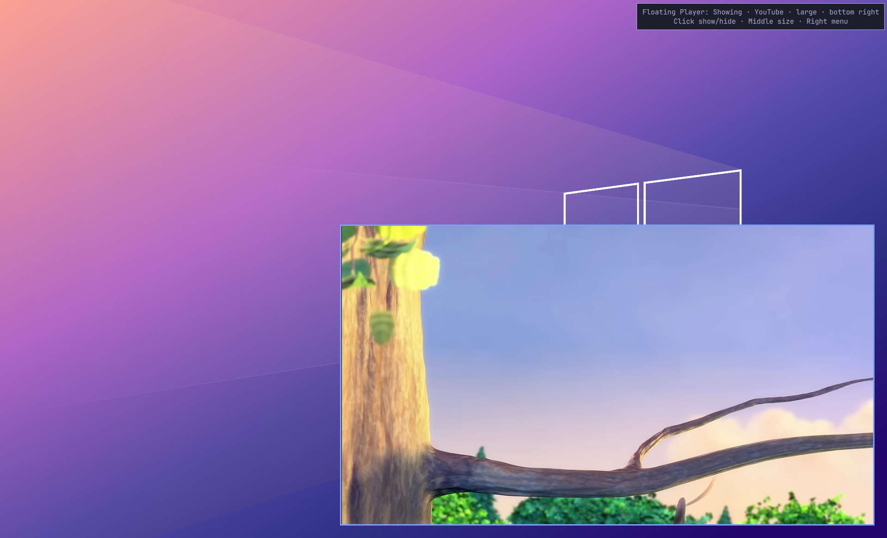

# Floating Player for Omarchy

A small, resizable, always-on-top **YouTube** and **YouTube TV** player for
[Omarchy](https://omarchy.org/). One player window floats above every app and
follows you across workspaces; a bar icon shows, hides, resizes and moves it.
Sign in by scanning a QR code with your phone, and send a video from your phone
to the player by holding its QR code up to the laptop camera.

An Omarchy shell plugin (`tamaker.floating-player`). It never edits your
Hyprland config: the window is floated, pinned and placed by launch rules and
`hyprctl` calls at runtime.

> **Unofficial.** Not affiliated with, endorsed by, or supported by YouTube or
> Google. It opens YouTube's own web apps in a browser window; you sign in with
> your own account, and your YouTube / YouTube TV subscription and Google's
> terms apply. If YouTube changes those apps, parts of this may stop working.



## Features

- **Two sources, one player.** YouTube runs YouTube's TV app (10-foot UI, works
  with the keyboard); YouTube TV runs its living-room app with live channels.
  Opening one closes the other.
- **Four sizes:** Small (~25 % of the screen width), Medium (~40 %), Large
  (~60 %), all 16:9, or real Fullscreen. Any corner. Stays clear of the bar.
- **Always on top, on every workspace.** Hide it to a special workspace and
  bring it back exactly where it was.
- **Adjustable transparency**, 20–100 % opaque, from a slider at the bottom of
  the menu, so you can keep watching while you work under it.
- **Picks up where you left off.** The player remembers the last source and
  reopens the video or live channel it was on (from the browser's own session
  data), at the size, corner and transparency you left it.
- **Phone sign-in.** The TV apps show a QR code; scan it with your phone and
  approve. No password typed on the laptop.
- **Camera QR scan.** On the phone, share a YouTube video as a QR code; hold it
  up to the laptop camera and it opens in the player.
- **Separate browser profiles** for the player (in
  `~/.local/share/floating-player/`), so your main browser is untouched.

## Requirements

- Omarchy with the Quickshell-based `omarchy-shell` and Hyprland's Lua config.
- Chromium (Omarchy's default; Google Chrome or Brave also work via
  `FP_BROWSER`). YouTube TV needs Widevine: the player copies it from
  `~/.config/chromium/WidevineCdm`, which Chromium downloads on its own the
  first time you play protected video in your normal browser.
- `jq`, `hyprctl`, `notify-send` (all on Omarchy).
- For camera scan: `ffmpeg`, `zbar`, `mpv`. For the sign-in check in web mode:
  `sqlite3`.

## Install

```bash
omarchy plugin add https://github.com/tamaker/omarchy-floating-player.git --enable
```

The 󰔂 icon lands in the right section of the bar.

## Use

| On the bar icon | Action |
|---|---|
| Left click | Show / hide the player (starts it if needed) |
| Middle click | Next size: Small → Medium → Large → Full |
| Right click | Menu: YouTube · YouTube TV · open link from clipboard · size · corner · sign in with phone · scan QR with camera · close · transparency slider |

In the menu: `y` / `t` sources, `p` clipboard link, `s` `m` `L` `f` sizes,
`1`–`4` corners, `x` close, `Esc` to dismiss.

### Sign in

Menu → **Sign in with phone (QR)**, or `floating-player signin youtube|youtubetv`.
The player grows to Large and opens the app's sign-in screen with a QR code.
Scan it with your phone camera (or go to `yt.be/activate` / `tv.youtube.com/start`
and enter the code), approve on the phone, done. YouTube and YouTube TV are
signed in separately. Google has no flow where the laptop scans the phone, so
the camera is not used for sign-in.

### Send a video from your phone

Menu → **Scan QR with camera**, or `floating-player scan`. A small camera
preview opens; on the phone, share a video as a QR code and hold it up. The
player opens it. Only http(s) links are accepted, and nothing scanned is ever
run.

### Keybindings (optional)

Plugins don't add keybindings. Add your own in `~/.config/hypr/bindings.lua`:

```lua
local fp = os.getenv("HOME") .. "/.config/omarchy/plugins/tamaker.floating-player/bin/floating-player"
o.bind("SUPER + Y", "Floating player: show / hide", fp .. " toggle")
o.bind("SUPER + CTRL + Y", "Floating player: next size", fp .. " size cycle")
o.bind("SUPER + ALT + Y", "Floating player: menu", "omarchy-shell tamaker.floating-player menu")
```

## Command line

```
floating-player open [youtube|youtubetv|<url>]
floating-player toggle | show | hide | close
floating-player size small|medium|large|full|cycle
floating-player corner tl|tr|bl|br|cycle
floating-player opacity 20-100             # percent, remembered
floating-player status                     # one JSON line
floating-player signin [youtube|youtubetv|all] [--wait] | --check
floating-player scan [--print] [--timeout N] [--device DEV]
```

`omarchy-shell tamaker.floating-player toggle|menu|open|size|corner|opacity|close`
does the same over shell IPC.

Settings (bar widget): `defaultSource` (youtube / youtubetv) and `defaultSize`
(small / medium / large):
`omarchy bar set tamaker.floating-player defaultSize large`.
Environment: `FP_RESUME=0` (always start on the home screen), `FP_BROWSER`, `FP_TV_UA` (TV user agent), `FP_YOUTUBETV_MODE=web`
(desktop tv.youtube.com with a normal Google sign-in instead of the TV app),
`FLOATING_PLAYER_CAMERA` (camera device).

## Remove

```bash
omarchy plugin remove tamaker.floating-player
rm -rf ~/.local/share/floating-player   # optional: forget sign-ins and profiles
```

## Caveats

- The TV apps are YouTube's living-room web apps reached with a TV user agent.
  YouTube can change them; if sign-in or playback breaks, try another `FP_TV_UA`.
- Widevine in desktop Chromium on Linux is software-level (L3). Live YouTube TV
  channels play; content that demands hardware DRM may not.
- The automatic key presses that bring up the sign-in QR depend on the TV apps'
  welcome screens; if they change, click "Sign in" yourself.
- Tested on one laptop (single monitor, Omarchy 4.0, Chromium 152). Multi-monitor placement uses the
  monitor the window is on.

## Screenshots

| Small, with the bar menu | Large |
|---|---|
|  |  |

Medium is the [preview](preview.png) at the top.

Video in the screenshots: *Big Buck Bunny* © Blender Foundation,
[CC BY 3.0](https://creativecommons.org/licenses/by/3.0/), www.bigbuckbunny.org.

## How it's built

`bin/floating-player` is the core (window lifecycle, sizes, state);
`bin/floating-player-signin` and `bin/floating-player-scan` handle sign-in and
camera; `Widget.qml` is the bar icon and menu. Design notes and what was tested
are in [`docs/`](docs/).

## License

MIT
